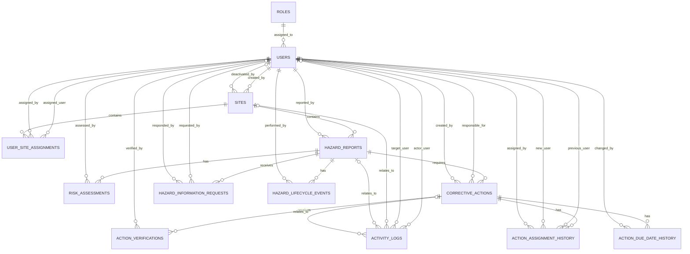

# Database Design — Construction Site Hazard Reporting and Corrective Action Management System

## 1. Introduction

This document describes the proposed relational database design for the Construction Site Hazard Reporting and Corrective Action Management System.

The database will use PostgreSQL and store information about users, construction sites, hazard reports, risk assessments, corrective actions, verification decisions and activity history.

The design is based on the requirements and business rules documented in:

- `docs/requirements.md`
- `docs/system-design.md`

The database must preserve historical information and maintain relationships between records throughout the hazard-management lifecycle.

## 2. Database Design Objectives

The database design aims to:

- Store information in a structured relational format.
- Support building and road construction sites.
- Support one organization managing multiple construction sites.
- Support users assigned to multiple sites.
- Maintain role-based and site-level access information.
- Preserve previous risk assessments.
- Support multiple corrective actions for one hazard.
- Preserve verification, reassignment and due-date histories.
- Maintain hazard closure and reopening history.
- Preserve important system activities.
- Enforce data integrity through primary keys, foreign keys, unique constraints and validation rules.

 
## 3. Database Entities

The proposed database contains the following main entities.

| No. | Entity | Purpose |
|---|---|---|
| 1 | roles | Stores system roles. |
| 2 | users | Stores user accounts and profile information. |
| 3 | sites | Stores construction site information. |
| 4 | user_site_assignments | Connects users to construction sites. |
| 5 | hazard_reports | Stores reported hazards. |
| 6 | risk_assessments | Stores risk assessment records and history. |
| 7 | corrective_actions | Stores corrective actions associated with hazards. |
| 8 | action_verifications | Stores verification decisions and comments. |
| 9 | hazard_information_requests | Stores requests for additional hazard information and worker responses. |
| 10 | action_assignment_history | Preserves initial assignments and subsequent reassignments. |
| 11 | action_due_date_history | Preserves initial due dates and subsequent due-date changes. |
| 12 | hazard_lifecycle_events | Preserves hazard closure and reopening events. |
| 13 | activity_logs | Records important system activities and status changes. |

  
## 4. Entity Relationship Diagram

The following Entity Relationship Diagram (ERD) illustrates the main database entities and their relationships. It includes the relationships required to support user management, multi-site access, hazard reporting, risk assessment, corrective actions, verification, history tracking, and activity logging.

## 5. Table Specifications

### 5.1 roles

Stores the four system roles.

| Attribute | Data type | Description |
|---|---|---|
| id | BIGINT | Primary key. |
| name | VARCHAR(30) | Role name. |
| description | TEXT | Description of the role. |

Initial role records:

- Worker
- Safety Officer
- Site Manager
- Administrator

Constraints:

- `id` is the primary key.
- `name` must be unique and not null.
- Only the four authorized role names are permitted in the initial system.

### 5.2 users

Stores system user accounts and profile information.

| Attribute | Data type | Description |
|---|---|---|
| id | BIGINT | Primary key. |
| role_id | BIGINT | Foreign key referencing roles. |
| full_name | VARCHAR(150) | User's full name. |
| email | VARCHAR(255) | User's email address. |
| password_hash | TEXT | Securely hashed password. |
| account_status | VARCHAR(20) | Active or Inactive. |
| created_at | TIMESTAMPTZ | Account creation date and time. |
| updated_at | TIMESTAMPTZ | Last update date and time. |

Constraints:

- `id` is the primary key.
- `role_id` references `roles.id`.
- `email` must be unique and not null.
- `password_hash` must not be null.
- Account status must be a permitted value.
- Passwords must never be stored in plain text.

### 5.3 sites

Stores information about building and road construction sites.

| Attribute | Data type | Description |
|---|---|---|
| id | BIGINT | Primary key. |
| name | VARCHAR(150) | Construction site name. |
| construction_type | VARCHAR(20) | Building or Road. |
| location | VARCHAR(255) | General site location. |
| description | TEXT | Additional site information. |
| status | VARCHAR(20) | Active or Inactive. |
| created_by | BIGINT | Administrator who registered the site. |
| created_at | TIMESTAMPTZ | Registration date and time. |
| deactivated_at | TIMESTAMPTZ | Date and time of deactivation, if applicable. |
| deactivated_by | BIGINT | Administrator who deactivated the site, if applicable. |

Constraints:

- `id` is the primary key.
- `created_by` references `users.id`.
- `deactivated_by` references `users.id` and may be null.
- Construction type must be Building or Road.
- Site status must be Active or Inactive.
- Deactivation must not delete existing site records or their associated operational records.

### 5.4 user_site_assignments

Connects users to construction sites and supports multiple site assignments.

| Attribute | Data type | Description |
|---|---|---|
| id | BIGINT | Primary key. |
| user_id | BIGINT | Foreign key referencing users. |
| site_id | BIGINT | Foreign key referencing sites. |
| assigned_by | BIGINT | Administrator who made the assignment. |
| assigned_at | TIMESTAMPTZ | Assignment date and time. |
| status | VARCHAR(20) | Active or Inactive assignment. |

Constraints:

- `id` is the primary key.
- `user_id` references `users.id`.
- `site_id` references `sites.id`.
- `assigned_by` references `users.id`.
- A user and site combination must not have duplicate assignment records.
- Only authorized administrators can create or deactivate site assignments.

### 5.5 hazard_reports

Stores hazard reports submitted by Workers.

| Attribute | Data type | Description |
|---|---|---|
| id | BIGINT | Primary key. |
| site_id | BIGINT | Construction site associated with the hazard. |
| reported_by | BIGINT | User who submitted the report. |
| title | VARCHAR(200) | Short hazard title. |
| description | TEXT | Detailed hazard description. |
| category | VARCHAR(100) | Hazard category. |
| location_description | TEXT | Specific location of the hazard. |
| building_floor | VARCHAR(100) | Building floor, when applicable. |
| building_room | VARCHAR(100) | Room or work area, when applicable. |
| road_section | VARCHAR(150) | Road section, when applicable. |
| chainage | VARCHAR(100) | Road chainage or kilometer reference, when applicable. |
| work_zone | VARCHAR(150) | Road work zone, when applicable. |
| status | VARCHAR(30) | Current hazard lifecycle status. |
| created_at | TIMESTAMPTZ | Report submission date and time. |
| updated_at | TIMESTAMPTZ | Last update date and time. |

Constraints:

- `id` is the primary key.
- `site_id` references `sites.id`.
- `reported_by` references `users.id`.
- Required report information must not be null.
- Hazard status must follow the approved hazard lifecycle.
- Building-specific and road-specific location fields may be null when they do not apply.
- Reports must remain associated with their original reporting user and construction site.

Initial hazard statuses:

- Submitted
- Under Review
- Needs More Information
- Risk Assessed
- Actions In Progress
- Awaiting Verification
- Closed
- Rejected

### 5.6 risk_assessments

Stores risk assessment results. Multiple records are permitted for one hazard so that reassessments do not overwrite previous decisions.

| Attribute | Data type | Description |
|---|---|---|
| id | BIGINT | Primary key. |
| hazard_id | BIGINT | Hazard being assessed. |
| assessed_by | BIGINT | Safety Officer performing the assessment. |
| likelihood | SMALLINT | Likelihood rating from 1 to 5. |
| severity | SMALLINT | Severity rating from 1 to 5. |
| risk_score | SMALLINT | Calculated likelihood multiplied by severity. |
| priority | VARCHAR(20) | Low, Moderate, High or Critical. |
| assessment_notes | TEXT | Explanation of the assessment. |
| assessed_at | TIMESTAMPTZ | Assessment date and time. |

Constraints:

- `id` is the primary key.
- `hazard_id` references `hazard_reports.id`.
- `assessed_by` references `users.id`.
- Likelihood must be between 1 and 5.
- Severity must be between 1 and 5.
- Risk score must equal likelihood multiplied by severity.
- Priority must follow the configured risk-rating rules.
- Previous assessment records must be retained.

Proposed priority thresholds:

| Risk score | Priority |
|---|---|
| 1–4 | Low |
| 5–9 | Moderate |
| 10–16 | High |
| 17–25 | Critical |

These thresholds must be documented and reviewed before operational use.

### 5.7 corrective_actions

Stores actions assigned to address reported hazards.

| Attribute | Data type | Description |
|---|---|---|
| id | BIGINT | Primary key. |
| hazard_id | BIGINT | Associated hazard report. |
| description | TEXT | Required corrective action. |
| responsible_user_id | BIGINT | User currently responsible for the action. |
| created_by | BIGINT | Safety Officer who originally created the action. |
| due_date | DATE | Current due date. |
| status | VARCHAR(30) | Current corrective-action status. |
| completion_notes | TEXT | Completion information submitted by the responsible user. |
| submitted_at | TIMESTAMPTZ | Date and time submitted for verification. |
| created_at | TIMESTAMPTZ | Action creation date and time. |
| updated_at | TIMESTAMPTZ | Last update date and time. |

Constraints:

- `id` is the primary key.
- `hazard_id` references `hazard_reports.id`.
- `responsible_user_id` references `users.id`.
- `created_by` references `users.id`.
- Each action must belong to one hazard.
- A hazard may have multiple corrective actions.
- The responsible user must be eligible and assigned to the relevant site.
- The assigning user must be an authorized Safety Officer.
- Status must follow the corrective-action lifecycle.

Initial corrective-action statuses:

- Assigned
- In Progress
- Submitted for Verification
- Changes Required
- Verified

An action's original creator and current responsible user must be retained independently of subsequent reassignment history.

### 5.8 action_verifications

Stores verification decisions for corrective actions.

| Attribute | Data type | Description |
|---|---|---|
| id | BIGINT | Primary key. |
| corrective_action_id | BIGINT | Action being verified. |
| verified_by | BIGINT | Safety Officer making the decision. |
| decision | VARCHAR(30) | Verified or Changes Required. |
| comments | TEXT | Verification comments. |
| verified_at | TIMESTAMPTZ | Verification date and time. |

Constraints:

- `id` is the primary key.
- `corrective_action_id` references `corrective_actions.id`.
- `verified_by` references `users.id`.
- Verification decisions must use permitted values.
- Verification must be performed by an authorized Safety Officer assigned to the relevant site.
- The current responsible user cannot verify the action.
- A Safety Officer who assigned or reassigned the action cannot verify it.
- Previous verification decisions must be retained.

The backend must enforce the independent-verification rules using the corrective-action assignment history. A database foreign key alone cannot enforce these authorization rules.

### 5.9 hazard_information_requests

Stores requests for additional information about a hazard report and the corresponding worker responses.

| Attribute | Data type | Description |
|---|---|---|
| id | BIGINT | Primary key. |
| hazard_id | BIGINT | Associated hazard report. |
| requested_by | BIGINT | Safety Officer requesting information. |
| request_explanation | TEXT | Reason for the information request. |
| requested_at | TIMESTAMPTZ | Request date and time. |
| response_text | TEXT | Information provided by the reporting Worker. |
| responded_by | BIGINT | Original reporting Worker who responded. |
| responded_at | TIMESTAMPTZ | Response date and time. |

Constraints:

- `id` is the primary key.
- `hazard_id` references `hazard_reports.id`.
- `requested_by` references `users.id`.
- `responded_by` references `users.id` and may be null until a response is submitted.
- Each request must have an explanation.
- Only the original reporting Worker may provide the requested information.
- A hazard may have multiple information requests.
- Previous requests and responses must remain available.

## 5.10 action_assignment_history

Preserves the initial assignment of each corrective action and all subsequent reassignments to maintain accountability and assignment history.

| Attribute | Data type | Description |
|---|---|---|
| id | BIGINT | Primary key. |
| corrective_action_id | BIGINT | Associated corrective action. |
| previous_user_id | BIGINT | Previously responsible user; null for the initial assignment. |
| new_user_id | BIGINT | Newly responsible user. |
| assigned_by | BIGINT | Safety Officer who performed the assignment or reassignment. |
| reason | TEXT | Explanation for reassignment; optional for initial assignment. |
| assigned_at | TIMESTAMPTZ | Date and time of the assignment event. |

**Constraints and business rules:**

- `id` is the primary key.
- `corrective_action_id` references `corrective_actions.id`.
- `previous_user_id` references `users.id` and may be null.
- `new_user_id` references `users.id`.
- `assigned_by` references `users.id`.
- Every corrective action's initial assignment must be recorded.
- Every reassignment must be recorded as a separate event.
- A reassignment must include a reason.
- An initial assignment does not require a reason.
- Previous assignment records must never be overwritten or deleted through normal application operations.
- Only an authorized Safety Officer can assign or reassign corrective actions.
- The current responsible user in `corrective_actions` must match the latest assignment history record.
- A Safety Officer who appears as `assigned_by` in any assignment history record for a corrective action must not verify that corrective action.
- All assignment events must be preserved for accountability and auditing.

### 5.11 action_due_date_history

Preserves the initial due date and all subsequent changes to corrective-action deadlines for accountability and auditing.

| Attribute | Data type | Description |
|---|---|---|
| id | BIGINT | Primary key. |
| corrective_action_id | BIGINT | Associated corrective action. |
| previous_due_date | DATE | Previous due date; null for the initial due-date record. |
| new_due_date | DATE | New or initially assigned due date. |
| changed_by | BIGINT | Safety Officer who set or changed the due date. |
| reason | TEXT | Explanation for changing the due date; optional for the initial assignment. |
| changed_at | TIMESTAMPTZ | Date and time the due date was set or changed. |

**Constraints and business rules:**

- `id` is the primary key.
- `corrective_action_id` references `corrective_actions.id`.
- `changed_by` references `users.id`.
- Every corrective action's initial due date must be recorded.
- The initial due-date record must have a null `previous_due_date`.
- Every subsequent due-date change must record both the previous and new due dates.
- The previous and new due dates must be different for subsequent changes.
- Every due-date change must include a reason.
- Only an authorized Safety Officer can set or change corrective-action due dates.
- The current due date in `corrective_actions` must match the latest recorded due-date history entry.
- Previous due-date records must never be overwritten or deleted through normal application operations.

 
### 5.12 hazard_lifecycle_events

Stores an immutable history of hazard closure and reopening events.

| Attribute | Data type | Description |
|---|---|---|
| id | BIGINT | Primary key. |
| hazard_id | BIGINT | Associated hazard report. |
| event_type | VARCHAR(20) | CLOSED or REOPENED. |
| performed_by | BIGINT | User who performed the event. |
| reason | TEXT | Explanation for the event. Required for no-action closures and reopening events; optional for verified-action closures. |
| closure_type | VARCHAR(30) | Verified Actions or No Action Required; null for reopening events. |
| created_at | TIMESTAMPTZ | Date and time of the event. |

**Constraints and business rules:**

- `id` is the primary key.
- `hazard_id` references `hazard_reports.id`.
- `performed_by` references `users.id`.
- `event_type` must be either CLOSED or REOPENED.
- For CLOSED events, `closure_type` must be either Verified Actions or No Action Required.
- For REOPENED events, `closure_type` must be null.
- A reason is required for No Action Required closures.
- A reason is required for every reopening event.
- A reason is optional for closures after verified corrective actions.
- Only an authorized Safety Officer can close or reopen a hazard.
- Closure after corrective actions requires all required corrective actions to be verified.
- No-action closure requires an appropriate risk assessment and a recorded explanation.
- Reopening requires a recorded reason.
- Every closure and reopening event must be stored as a separate record.
- Previous lifecycle events must never be overwritten or deleted through normal application operations.

### 5.13 activity_logs

Records important system activities, administrative operations, and workflow changes to provide an auditable history of system operations.

| Attribute | Data type | Description |
|---|---|---|
| id | BIGINT | Primary key. |
| actor_user_id | BIGINT | User who performed the activity; null for system-generated events. |
| site_id | BIGINT | Related construction site, when applicable. |
| hazard_id | BIGINT | Related hazard report, when applicable. |
| corrective_action_id | BIGINT | Related corrective action, when applicable. |
| target_user_id | BIGINT | User account affected by the activity, when applicable. |
| activity_type | VARCHAR(100) | Categorized type of activity performed. |
| description | TEXT | Details explaining the activity. |
| previous_status | VARCHAR(30) | Previous status, when applicable. |
| new_status | VARCHAR(30) | New status, when applicable. |
| created_at | TIMESTAMPTZ | Date and time the activity occurred. |

**Constraints and business rules:**

- `id` is the primary key.
- `actor_user_id` references `users.id` and may be null for system-generated events.
- `site_id` references `sites.id` and may be null when no specific site applies.
- `hazard_id` references `hazard_reports.id` and may be null when no specific hazard applies.
- `corrective_action_id` references `corrective_actions.id` and may be null when no specific corrective action applies.
- `target_user_id` references `users.id` and may be null when no user account is affected.
- `activity_type` must identify the category of activity performed.
- Every activity record must include a description and creation timestamp.
- Important workflow changes and administrative actions must be recorded.
- Activity records must be append-only during normal application operations.
- Existing activity records must not be edited or deleted through normal application operations.
- Activity records must preserve the identity of the actor whenever an authenticated user performs an activity.
- Activity history must be accessible only according to authorized administrative permissions, user roles, and site assignments.
- Sensitive information, including passwords, authentication tokens, and secret credentials, must never be stored in activity descriptions.
- Activity logs supplement specialized history tables; they do not replace assignment, due-date, verification, or hazard lifecycle history.

 
## 6. Main Database Relationships

The principal relationships between the database entities are:

1. One role can be associated with many users.
2. One user can be assigned to multiple construction sites.
3. One construction site can have multiple assigned users.
4. One construction site can contain multiple hazard reports.
5. One reporting user can submit multiple hazard reports.
6. One hazard report can have multiple risk assessments.
7. One hazard report can have multiple corrective actions.
8. One corrective action can have multiple verification records.
9. One hazard report can have multiple information requests.
10. One corrective action can have multiple assignment-history records.
11. One corrective action can have multiple due-date-history records.
12. One hazard report can have multiple hazard lifecycle events.
13. One user can generate multiple activity records.
14. One construction site can be associated with multiple activity records.

## 7. Important Database Business Rules

The database and backend must work together to enforce the following rules.

### 7.1 User and Site Access

- Users must have an active account to perform protected operations.
- Users must have an appropriate role for the requested operation.
- Operational users must be assigned to the relevant construction site.
- Administrators can manage system-wide user and site information.
- Deactivated sites cannot receive new hazard reports or newly created corrective actions.
- Existing hazards and corrective actions must remain accessible to authorized users after site deactivation.
- Existing corrective actions must continue through their normal workflow after site deactivation.

### 7.2 Hazard Reporting and Risk Assessment

- Every hazard report belongs to one construction site.
- Every hazard report identifies its original reporting user.
- Every risk assessment belongs to one hazard report.
- Likelihood and severity must each be between 1 and 5.
- The risk score is calculated by multiplying likelihood by severity.
- Risk priority is determined using the following proposed thresholds:
  - 1–4: Low
  - 5–9: Moderate
  - 10–16: High
  - 17–25: Critical
- The risk score and priority must be consistent with the recorded likelihood and severity.
- Previous risk assessments must be preserved.
- The current risk assessment is determined by the most recent valid assessment record.

These risk thresholds must be reviewed against appropriate occupational safety guidance before operational use.

### 7.3 Corrective Actions and Verification

- One hazard may have multiple corrective actions.
- Every corrective action has one current responsible user.
- Every initial assignment and reassignment must be recorded.
- Every due-date change must be recorded with its reason.
- The current responsible user cannot verify their own action.
- No Safety Officer who assigned or reassigned an action may verify that action.
- Verification decisions, including requests for changes and successful verification, must be preserved.
- A hazard requiring corrective actions cannot close until all required actions are verified.

### 7.4 Closure and Reopening

- A hazard may close after all required corrective actions are verified.
- A risk-assessed hazard may close without corrective actions when the Safety Officer records a valid explanation.
- A closed hazard may be reopened by an authorized Safety Officer with a recorded reason.
- Every closure and reopening must be stored as a separate lifecycle event.
- Previous closure and verification history must remain available.

  
## 8. Data Integrity and Database Constraints

The PostgreSQL database will use:

- Primary keys to uniquely identify records.
- Foreign keys to maintain relationships between tables.
- Unique constraints to prevent duplicate user emails and duplicate user-site assignments.
- NOT NULL constraints for required attributes.
- CHECK constraints for permitted status values, numeric ranges, and valid risk classifications.
- Transactions for operations that update multiple related records.
- Appropriate indexes for frequently queried foreign keys, statuses, and due dates.
- Appropriate foreign-key deletion rules to prevent accidental loss of referenced records.

Important records such as risk assessments, verification decisions, assignment history, due-date history, hazard lifecycle events, and activity logs must not be physically deleted through normal application operations.

Historical records should be retained even when users or sites become inactive.

The database must maintain consistency between current operational records and their corresponding history records.

 

## 9. Security Considerations

- Passwords will be stored only as secure password hashes.
- Backend authorization must be checked before protected database operations.
- SQL queries must use parameterized operations.
- Operational users must not access or modify records belonging to sites to which they are not assigned.
- Authorized administrators may access system-wide user and site information according to their permissions.
- Historical records must not be editable through ordinary user operations.
- Database credentials must be kept outside source control.
- Database access must be restricted to the backend application and authorized administrative processes.
- Sensitive authentication information must not be stored in activity logs.

 

## 10. Scope and Future Database Extensions

The initial database design focuses on the core hazard-management workflow.

The following features are not required for the first implementation:

- Evidence file storage and attachment metadata.
- SMS notification records.
- Real-time chat messages.
- AI-based hazard predictions.
- Advanced analytics and external integrations.

Evidence attachment tables may be added after the core workflow is implemented and tested.

The exact authentication session storage structure will be decided when the authentication and session-management approach is finalized.

## 11. Next Database Design Activities

The following activities will be completed before database implementation:

1. Review the proposed entities and relationships.
2. Resolve any remaining database design issues.
3. Define exact PostgreSQL column types and constraints.
4. Finalize the Entity Relationship Diagram.
5. Review normalization and data integrity.
6. Prepare the initial SQL schema.
7. Test the schema and relationships in PostgreSQL.