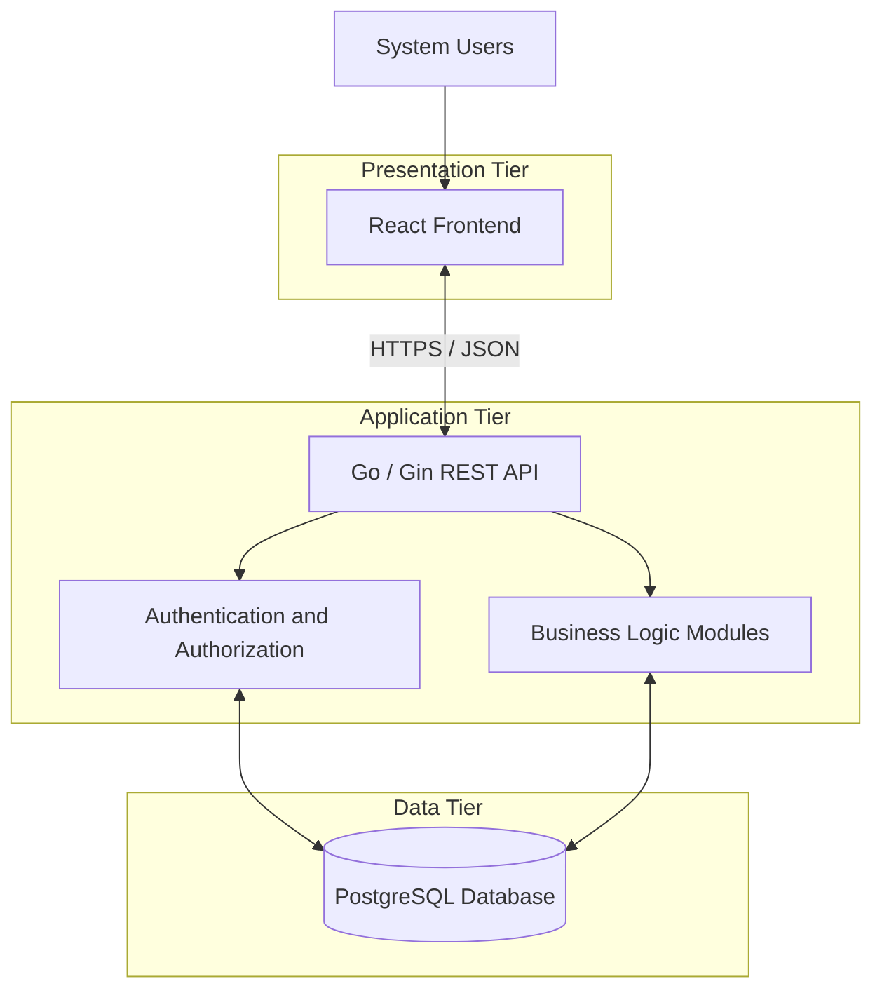

# System Design — Construction Site Hazard Reporting and Corrective Action Management System

## 1. Introduction

This document describes the high-level architecture of the Construction Site Hazard Reporting and Corrective Action Management System.

The system is designed as a web-based application that supports hazard reporting, risk assessment, corrective-action management, verification, monitoring, and activity tracking across building and road construction projects.

The architecture follows a client-server model with a centralized backend and relational database.

## 2. Architectural Style

The system will use a **three-tier client-server architecture**.

The three main tiers are:

1. Presentation Tier (Frontend)
2. Application Tier (Backend)
3. Data Tier (Database)

The backend will follow a modular monolithic architecture. This means the application will run as one backend service while its internal responsibilities are organized into separate modules.

This approach is suitable for the academic project because it keeps development and deployment manageable while maintaining clear separation of responsibilities.

## 3. Main System Components

### 3.1 Presentation Tier — Frontend

**Technology:** React, TypeScript, Vite and Tailwind CSS.

Responsibilities:

- Provide the user interface.
- Display role-specific dashboards.
- Allow Workers to submit hazard reports.
- Allow Safety Officers to review hazards and assess risks.
- Allow authorized users to manage corrective actions.
- Display action progress, overdue actions and activity history.
- Send requests to the backend through REST API endpoints.
- Display responses and validation messages.

The frontend is responsible for presentation and user interaction. It is not responsible for enforcing security or making final authorization decisions.

### 3.2 Application Tier — Backend

**Technology:** Go and Gin.

The backend is the central application layer and is responsible for processing requests and enforcing system rules.

Responsibilities:

- Authenticate users.
- Authorize operations according to user roles and site assignments.
- Validate incoming requests.
- Manage construction sites and user-site assignments.
- Process hazard reports.
- Perform risk-score calculations and priority classification.
- Manage corrective-action assignments and deadlines.
- Process corrective-action verification and hazard closure.
- Maintain activity and audit history.
- Communicate with the PostgreSQL database.
- Return appropriate responses to the frontend.

The backend must enforce all important business rules defined in the Software Requirements Specification.

### 3.3 Data Tier — Database

**Technology:** PostgreSQL.

The database provides persistent storage for system information.

It will store:

- User accounts and role information.
- Construction sites.
- User-site assignments.
- Hazard reports.
- Risk assessments and assessment history.
- Corrective actions.
- Verification records.
- Activity and audit history.

The database will use relational structures, primary keys, foreign keys and appropriate constraints to maintain data integrity.

## 4. High-Level Architecture Diagram

## 5. Backend Module Responsibilities

The backend will be organized into logical modules:

| Module | Main responsibility |
|---|---|
| Authentication | Login, logout and user identity |
| User Management | User accounts, roles and assignments |
| Site Management | Construction site registration and status |
| Hazard Management | Hazard reporting, review, rejection and reopening |
| Risk Assessment | Likelihood, severity, score and priority |
| Corrective Actions | Assignment, reassignment, progress and deadlines |
| Verification | Independent verification and hazard closure |
| Activity History | Recording important system activities |
| Dashboard and Reports | Providing role-specific summaries |

These are logical modules within one backend application, not separate services.

## 6. Main Request and Data Flow

The system will process user operations through the following general sequence:

1. A user interacts with the React frontend.
2. The frontend sends an HTTP request to the Go backend.
3. The backend identifies the authenticated user.
4. The backend checks the user's role and construction-site access.
5. The backend validates the request and applicable business rules.
6. The backend reads or updates the PostgreSQL database.
7. The backend returns an appropriate HTTP response.
8. The frontend displays the result to the user.

All protected operations must be authorized by the backend before data is accessed or modified.

## 7. Authentication and Authorization Architecture

The system will support four user roles:

- Worker
- Safety Officer
- Site Manager
- Administrator

Authentication will establish the identity of the user.

Authorization will determine which operations and records the authenticated user can access.

The backend will enforce:

- Role-based access control.
- Site-level access restrictions.
- Restrictions on sensitive operations.
- Independent verification rules.
- Administrative permissions.

Users will only access construction-site records for sites to which they are assigned, except for authorized administrative operations.

The frontend may hide unavailable functions, but backend authorization remains mandatory.

The detailed authentication and session-management approach will be documented during the authentication design task.

## 8. Multi-Site Architecture

The system will support one organization managing multiple building and road construction sites.

Each operational record associated with a construction site must be linked to the appropriate site.

Workers, Safety Officers and Site Managers will be assigned to one or more construction sites.

The backend will enforce site-level access restrictions so that users cannot access records belonging to unassigned sites.

Administrators will have authorized system-wide site and user management capabilities.

## 9. Security and Data Integrity

The architecture will support the following security and integrity measures:

- Passwords must be securely hashed.
- Protected backend endpoints must require authentication.
- Role and site permissions must be checked on the backend.
- Database queries must use parameterized operations.
- Incoming data must be validated.
- Important workflow changes must be recorded.
- Sensitive information must not be exposed in error responses.
- Database relationships and constraints must preserve data integrity.
- Corrective actions must not be verified by their responsible users or assigning Safety Officers.

## 10. Deployment Overview

During development, the system will run locally.

The frontend development server will provide the user interface, the Go application will provide the REST API, and PostgreSQL will store application data.

For a future deployment, the frontend, backend and database may run on separate hosting environments while communicating through secured network connections.

The exact hosting environment and deployment configuration will be decided later.

## 11. Architectural Decisions

| Decision | Selected approach | Reason |
|---|---|---|
| Application architecture | Three-tier architecture | Separates presentation, business logic and data |
| Backend structure | Modular monolith | Keeps development manageable |
| Frontend | React with TypeScript | Component-based interface and type safety |
| Frontend tooling | Vite | Lightweight development tooling |
| Backend | Go with Gin | Structured REST API development |
| Database | PostgreSQL | Relational data and integrity constraints |
| Communication | REST API with JSON | Clear frontend-backend communication |
| Deployment during development | Local environment | Avoids unnecessary infrastructure complexity |

## 12. Scope of This Architecture

This architecture covers the core web application and its communication between the frontend, backend and database.

The following are outside the initial architecture scope:

- Microservices.
- Artificial intelligence hazard prediction.
- SMS notifications.
- Real-time chat.
- Native mobile applications.
- Advanced external integrations.
- Distributed deployment infrastructure.

These may be considered as future enhancements if justified by the project requirements.

## 13. Relationship to Other Design Documents

This document provides the high-level architectural foundation.

The following design activities will provide more detail:

1. Database Design — tables, attributes, relationships and constraints.
2. API Design — REST endpoints, request formats and response formats.
3. Authentication and Authorization Design — session handling and permission enforcement.
4. User Interface Design — screens, navigation and role-specific dashboards.